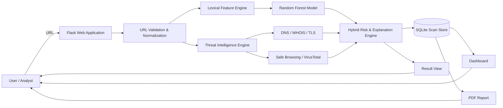
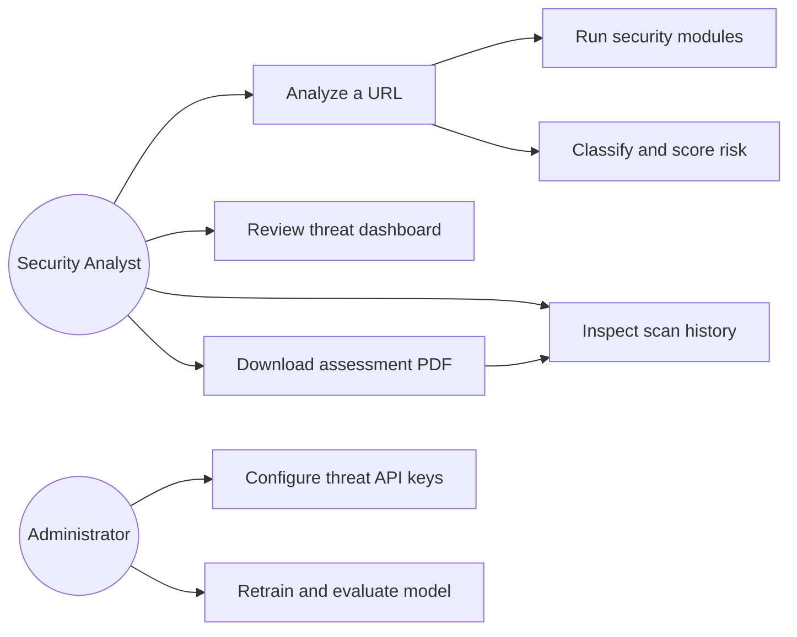

# Architecture and database design

## Data-flow diagram (Level 1)

## Use-case diagram

## Database schema

The `scans` table stores normalized URL, final classification and scores, summarized intelligence status, JSON findings/recommendations, the complete result JSON, and UTC creation time. Indexes cover time-ordered history and classification aggregation. Schema creation is idempotent in `services/database.py`.

## Scoring design

The final score is not simply the model probability. It weights URL structure (18%), keywords (14%), domain intelligence (12%), transport/TLS (13%), reputation (25%), and ML output (18%). A positive configured blacklist result raises risk to at least 90. Thresholds are: Legitimate below 30, Suspicious from 30 to 64.9, and Phishing from 65. AMTSO official test paths are explicitly classified as Security Test before ordinary scoring.

